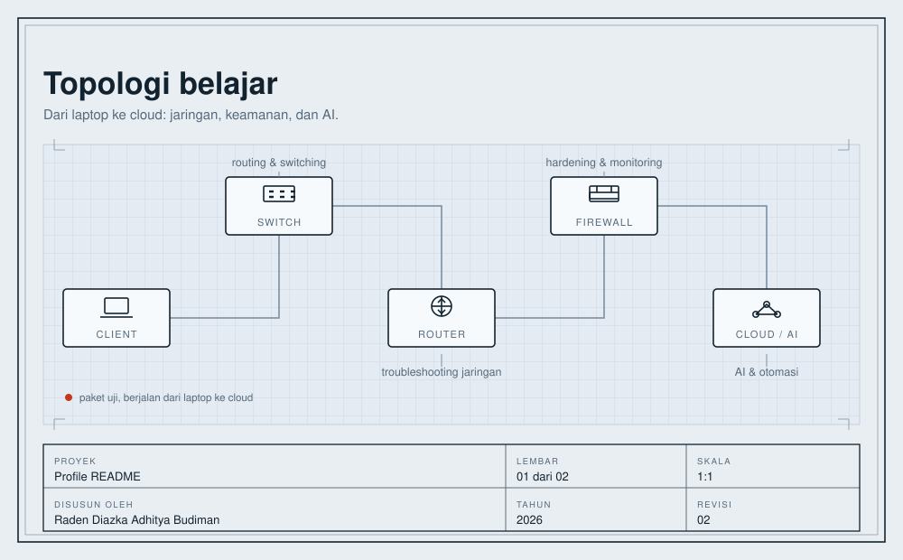
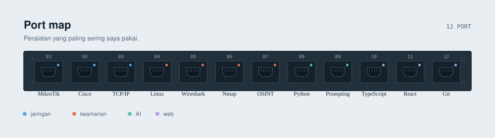

  

Saya Raden Diazka Adhitya Budiman, pelajar SMK jurusan TJKT di Indonesia. Saya belajar jaringan komputer, keamanan, dan AI dengan membangun hal kecil lalu membukanya di sini.

Portofolio lengkap ada di [raden-diazka.github.io](https://raden-diazka.github.io/), dan demo dashboard PKL bisa dicoba di [dashboard-pkl-chi.vercel.app](https://dashboard-pkl-chi.vercel.app).

## Yang sedang saya kerjakan

- Konfigurasi jaringan: routing, switching, dan troubleshooting perangkat.
- Keamanan dari sisi bertahan: hardening layanan, membaca trafik, dan analisis log.
- AI dan web untuk membuat tools kecil yang benar-benar saya pakai.

## Port map

  

## Proyek

| Proyek | Isi | Stack |
| --- | --- | --- |
| [dashboard-pkl](https://github.com/raden-diazka/dashboard-pkl) | Dashboard manajemen PKL, dengan [demo langsung](https://dashboard-pkl-chi.vercel.app). | TypeScript, Vercel |
| [raden-diazka.github.io](https://github.com/raden-diazka/raden-diazka.github.io) | Situs portofolio pribadi yang tayang di GitHub Pages. | HTML, CSS, JavaScript |
| [raden-diazka-introduction](https://github.com/raden-diazka/raden-diazka-introduction) | Halaman perkenalan, minat, dan tujuan karier. | HTML, CSS |

Repo yang saya pelajari (fork)

 

- [AI-For-Beginners](https://github.com/raden-diazka/AI-For-Beginners): kurikulum 12 minggu untuk belajar AI.
- [INSTA-OSINT](https://github.com/raden-diazka/INSTA-OSINT): pengumpulan informasi akun Instagram.
- [GhostTrack](https://github.com/raden-diazka/GhostTrack): latihan pelacakan lokasi dan nomor.
- [Soal-LKS-ITNSA](https://github.com/raden-diazka/Soal-LKS-ITNSA): soal latihan LKS bidang IT Network Systems Administration.

## Aktivitas di GitHub

  
  

## Kontak

Terbuka untuk kolaborasi, lomba, dan diskusi soal jaringan atau keamanan. Kirim pesan lewat [GitHub](https://github.com/raden-diazka), atau lihat karya lain di [situs portofolio](https://raden-diazka.github.io/).
