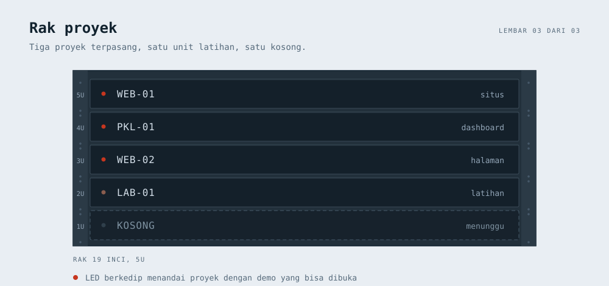

  <picture>
    <source media="(max-width: 620px)" srcset="./assets/terminal-sempit.svg" />
    
  </picture>

  <picture>
    <source media="(max-width: 620px)" srcset="./assets/topologi-sempit.svg" />
    
  </picture>

Saya Raden Diazka Adhitya Budiman, pelajar SMK TJKT di Indonesia. Saya belajar jaringan komputer, keamanan, dan AI dengan membangun hal kecil lalu membukanya di sini.

## Yang sedang saya kerjakan

- Konfigurasi jaringan: routing, switching, dan troubleshooting perangkat.
- Keamanan dari sisi bertahan: hardening layanan, membaca trafik, dan analisis log.
- AI dan web untuk membuat tools kecil yang benar-benar saya pakai.

## Port map

  <picture>
    <source media="(max-width: 620px)" srcset="./assets/port-map-sempit.svg" />
    
  </picture>

## Proyek

  <picture>
    <source media="(max-width: 620px)" srcset="./assets/rak-proyek-sempit.svg" />
    
  </picture>

- `PKL-01` [dashboard-pkl](https://github.com/raden-diazka/dashboard-pkl) — dashboard manajemen PKL dengan TypeScript dan Vercel. Demonya bisa dibuka di [dashboard-pkl-chi.vercel.app](https://dashboard-pkl-chi.vercel.app).
- `WEB-01` [raden-diazka.github.io](https://github.com/raden-diazka/raden-diazka.github.io) — situs portofolio pribadi yang tayang di GitHub Pages, dibangun dengan HTML, CSS, dan JavaScript.
- `WEB-02` [raden-diazka-introduction](https://github.com/raden-diazka/raden-diazka-introduction) — halaman perkenalan, minat, dan tujuan karier, dibangun dengan HTML dan CSS.
- `LAB-01` — empat repo fork yang saya pakai untuk latihan, daftarnya ada di bawah.

Repo yang saya pelajari (fork)

 

- [AI-For-Beginners](https://github.com/raden-diazka/AI-For-Beginners): kurikulum 12 minggu untuk belajar AI.
- [INSTA-OSINT](https://github.com/raden-diazka/INSTA-OSINT): pengumpulan informasi akun Instagram.
- [GhostTrack](https://github.com/raden-diazka/GhostTrack): latihan pelacakan lokasi dan nomor.
- [Soal-LKS-ITNSA](https://github.com/raden-diazka/Soal-LKS-ITNSA): soal latihan LKS bidang IT Network Systems Administration.

## Aktivitas di GitHub

  
  

## Kontak

Terbuka untuk kolaborasi, lomba, dan diskusi soal jaringan atau keamanan. Kirim pesan lewat [GitHub](https://github.com/raden-diazka), atau lihat karya lain di [situs portofolio](https://raden-diazka.github.io/).
