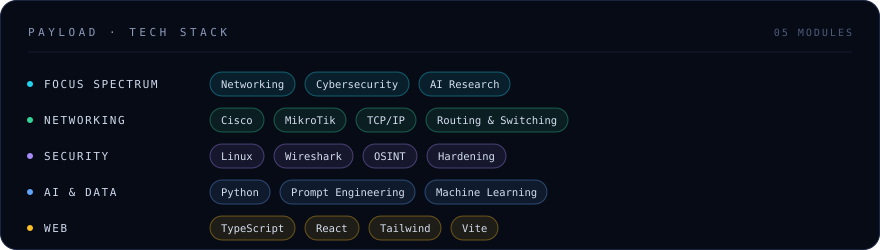

<!--
  ╔══════════════════════════════════════════════════════════════════╗
  ║  SOLAR SYSTEM · @raden-diazka                                    ║
  ║  planets = focus areas · orbits = curiosity · sun = me           ║
  ╚══════════════════════════════════════════════════════════════════╝
-->

  

 

  <b>RADEN DIAZKA ADHITYA BUDIMAN</b> · PELAJAR SMK TJKT · INDONESIA 
  NETWORKING&nbsp;&nbsp;·&nbsp;&nbsp;CYBERSECURITY&nbsp;&nbsp;·&nbsp;&nbsp;AI

 

  
  
  

<h3 align="center"><code>01 · TENTANG</code></h3>

Halo! Saya **Raden Diazka Adhitya Budiman** — pelajar SMK jurusan **TJKT** (Teknik Jaringan Komputer dan Telekomunikasi) di Indonesia. Saya sedang mengejar keahlian di bidang **jaringan komputer**, **cybersecurity**, dan **pengembangan AI**.

Cara saya belajar: membangun sesuatu yang nyata, lalu mempublikasikannya. Mulai dari dashboard manajemen PKL, situs portofolio, sampai eksperimen OSINT dan keamanan jaringan — semuanya saya dokumentasikan terbuka di sini.

| `SEKARANG` | `SEDANG_DIPELAJARI` | `MISI` |
| :-- | :-- | :-- |
| Belajar jaringan, keamanan, dan AI lewat proyek nyata | Linux server, hardening jaringan, dasar machine learning | Menjadi praktisi cybersecurity yang juga bisa membangun produk |

<h3 align="center"><code>02 · STACK</code></h3>

  

<h3 align="center"><code>03 · PROYEK_PILIHAN</code></h3>

  
  

| `PROYEK` | `APA_ITU` | `STACK` |
| :-- | :-- | :-- |
| **[dashboard-pkl](https://github.com/raden-diazka/dashboard-pkl)** | Dashboard manajemen PKL — [live demo](https://dashboard-pkl-chi.vercel.app) | TypeScript · Vercel |
| **[raden-diazka.github.io](https://raden-diazka.github.io/)** | Situs portofolio pribadi yang tayang di GitHub Pages | HTML · CSS · JS |
| **[raden-diazka-introduction](https://github.com/raden-diazka/raden-diazka-introduction)** | Halaman perkenalan: profil, minat, dan tujuan karier di cybersecurity & AI | HTML · CSS |

<code>&nbsp;ARSIP ·&nbsp;</code> repo yang saya pelajari / fork

 

- **[AI-For-Beginners](https://github.com/raden-diazka/AI-For-Beginners)** — kurikulum 12 minggu untuk belajar AI
- **[INSTA-OSINT](https://github.com/raden-diazka/INSTA-OSINT)** — tool pengumpulan informasi akun Instagram
- **[GhostTrack](https://github.com/raden-diazka/GhostTrack)** — pelacakan lokasi / nomor (latihan OSINT)
- **[Soal-LKS-ITNSA](https://github.com/raden-diazka/Soal-LKS-ITNSA)** — soal latihan LKS bidang IT Network Systems Administration

<h3 align="center"><code>04 · ORBIT_STATS</code></h3>

  
  

  

  

<h3 align="center"><code>05 · SIGNAL</code></h3>

  Terbuka untuk kolaborasi, lomba, dan diskusi seputar jaringan, keamanan, dan AI. 
  Kirim sinyal lewat <a href="https://github.com/raden-diazka">GitHub</a> atau lihat karya lain di <a href="https://raden-diazka.github.io/">situs portofolio</a>.

 

  <code>◆</code> dirancang di orbit · <a href="https://github.com/raden-diazka">@raden-diazka</a> · 2026

